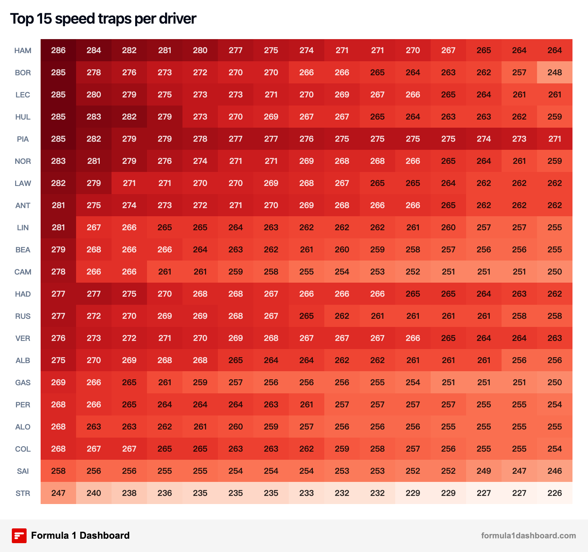
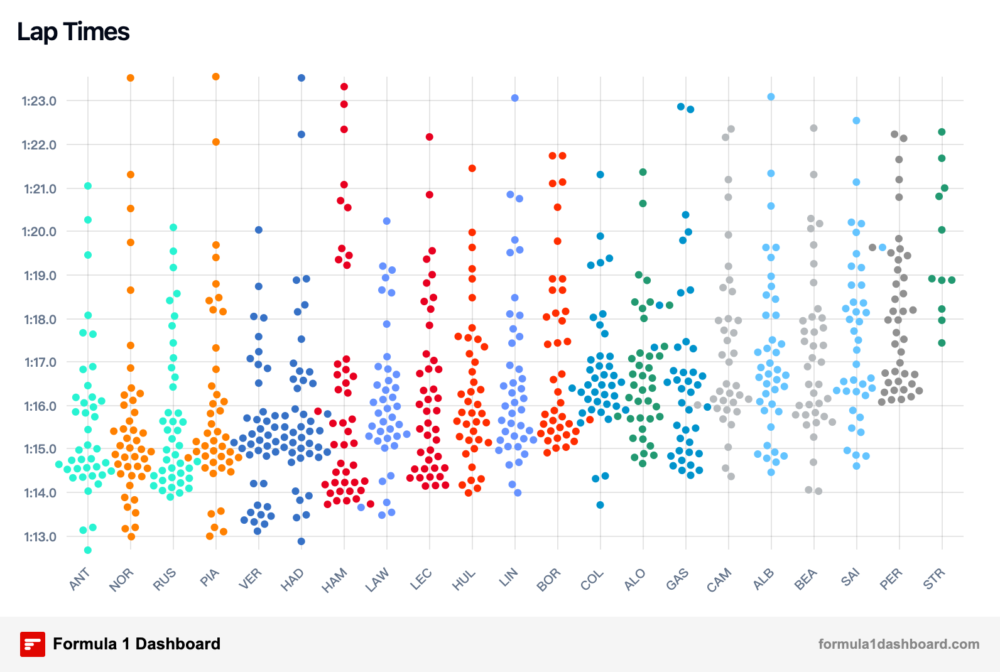
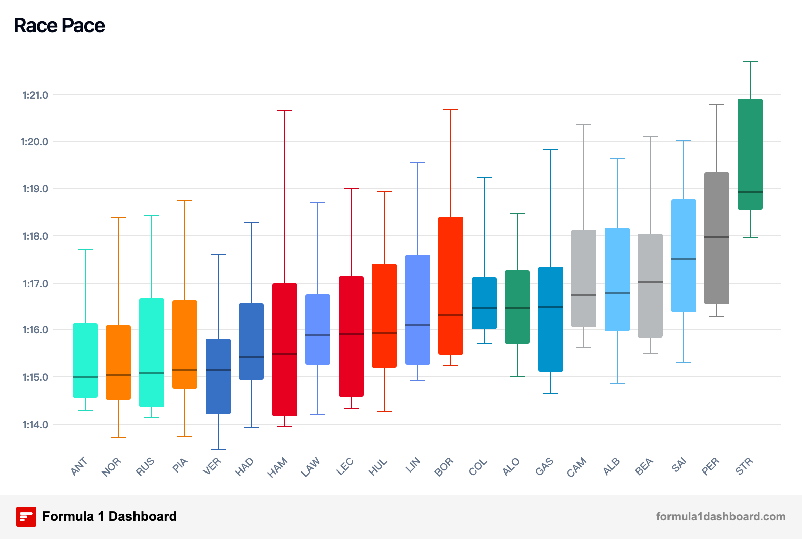
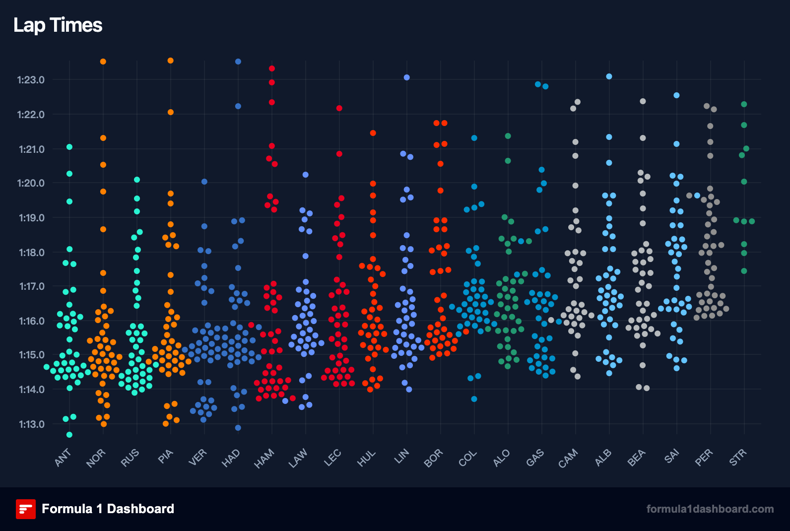

# 视觉规范：一张图怎么长

> 这份规范不教“怎么做出高级感”，只回答：**一张要独立被看见的数据图，画面应该怎么安排。**
> 适用于图表页、数据卡片、文章配图、社媒长图。规则不绑定行业，换一组对象和指标就能直接用。

---

## 1. 想达到的效果

| 想要 | 不要 |
| --- | --- |
| 第一眼看到答案 | 第一眼看到边框、阴影、装饰 |
| 一张图一个主角 | 一屏塞三张图、五个指标 |
| 颜色有含义 | 颜色只是“好看” |
| 数字读得到 | 只靠颜色猜大小 |
| 截屏后仍知道出处 | 截屏后不知道是谁做的 |

**一句话**：把画面让给数据，把装饰减到零，把出处留在页脚。

---

## 2. 画面骨架

一张图从上到下只有四件事：

```
标题          一句话，说明这张图回答什么
（留白）
图            画面主角，占大部分面积
（留白）
页脚          品牌签名 + 出处
```

### 2.1 标题

- 放在左上角，不和图抢中线。
- 一句话，不加副标题、不加“图表”二字、不加问号堆叠。
- 字号最大、字重最粗；它是整张图唯一“喊出来”的内容。
- 标题要能独立成立：把图遮住，只看标题，也知道这张图要说什么。

### 2.2 图

- 一张图只放一个主视觉；不要在同一张图里塞两个坐标轴、两种完全不同的图。
- 图内不写长句；需要解释的内容放到图外的说明或鼠标移上后的浮窗。
- 图不套外框：没有边框、没有圆角、没有阴影、没有渐变背景。

### 2.3 页脚

- 一条与画面同宽的色带，左边品牌标识，右边出处。
- 页脚是“签名”，不是导航：不放菜单、不放版权声明、不放更新时间。
- 页脚颜色比画面深一阶（白天浅灰、夜晚近黑蓝），形成一条稳定的收尾。

### 2.4 画面比例

以约 1600 宽的参考画面为例：

- 左右留白约为画面宽度的 **2%**。
- 标题字高约为画面宽度的 **2.5%**；标题到图约一个标题字高。
- 图到页脚约一个标题字高（约 42）。
- 页脚高约为画面宽度的 **5.5%**（约 88）。
- 图本身占画面高度的 **60%–70%**；不要让标题和页脚把图挤扁。

> 这些比例比具体数字重要。换到别的尺寸时，按比例缩放，不要只改字号不改留白。

---

## 3. 留白与节奏

- **留白是固定的**：标题上、标题下、图下、页脚内，四个间距全站统一。
- 不要把留白“用满”：图与页脚之间必须留出呼吸，避免数据贴边。
- 同一组图上下排列时，标题基线、图顶、图底、页脚顶要对齐；不要一张高一张低。
- 留白不是“空”，它是让眼睛休息、让数据分组的手段。

**三个不要**

1. 不要在标题下加一条装饰线。
2. 不要在图的四周加内边距框。
3. 不要为了“饱满”把图拉到贴边。

---

## 4. 颜色

颜色在这套规范里只有两种工作：**区分对象**、**表达强弱**。不做装饰，不做情绪。

### 4.1 五种基本色

| 角色 | 白天 | 夜晚 | 用在哪 |
| --- | --- | --- | --- |
| 纸白 / 夜蓝 | 纯白 | 深海军蓝 | 主画面 |
| 深墨 / 月白 | 近黑 | 近白 | 标题、主要数字 |
| 雾灰 | 中性灰 | 浅蓝灰 | 刻度、对象代码、次要说明 |
| 浅灰 | 浅灰 | 深灰蓝 | 网格线、分隔线 |
| 页脚色 | 浅灰 | 近黑蓝 | 页脚色带 |

- 夜晚不是把白天反过来：主画面用**亮一阶的深蓝**，页脚用**更深的近黑蓝**，形成两层深色。全黑会让网格和对象色都显脏。
- 文字只用深墨/月白/雾灰；不要用对象色写字。

### 4.2 分组色

- 每个对象组有一个固定颜色；**同组共用一色**（同组两个对象同色）。
- 分组色只出现在点、箱体、色块、描边；不进入文字、不进入页脚、不进入按钮。
- 分组色必须实心使用，不要加透明度；需要弱化时，淡化其他对象，不要淡化颜色本身。
- 对象多时，靠“位置 + 名称”区分，不要硬凑几十种颜色。

### 4.3 强弱色（色块矩阵）

- 用一个色相从浅到深，表达数值从小到大的强弱。
- 白天：浅珊瑚 → 深酒红；数值越大，颜色越重。
- 夜晚：建议反过来，数值越大越亮，避免一大块浅色压在深色画面上。
- 强弱色只表达“相对”，精确值必须用数字写出来。

### 4.4 品牌色

- 品牌色只属于 Logo 和品牌签名，**不能**用来表示数据。
- 数据里可能已经有相近的颜色；再加品牌色，读者会分不清“这个颜色到底代表谁”。

### 4.5 五条用色规则

1. 颜色只用来区分对象或表达强弱，不做装饰。
2. 一种颜色只代表一个对象组；同组同色。
3. 颜色不能是唯一线索：必须有名称、位置或数字兜底。
4. 深色底用白字，浅色底用深字；中间调要特别小心，必要时改用纯白或近黑。
5. 品牌色与数据色不在同一层出现。

---

## 5. 字

### 5.1 四个层级

| 层级 | 样子 | 用在哪 |
| --- | --- | --- |
| 标题 | 最大、最粗 | 页面标题，一句话 |
| 主数字 | 大、粗、居中 | 色块矩阵格子里的数字 |
| 对象名 | 中等、半粗、大写 | 对象代码、分组名 |
| 刻度/说明 | 小、中等、灰 | 坐标刻度、单位、注释 |

- 标题和图内文字要拉开明显差距；不要所有字都差不多大。
- 数字要等宽、对齐；同一列的小数位要一致。
- 单位只出现一次（标题旁、轴旁或说明里），不要每个数字都带单位。
- 大写只用于对象代码和很短的标签；长句不要全大写。
- 标题不加副标题；需要解释口径，放到图外的说明或浮窗里。

### 5.2 数字写法

| 内容 | 写法 | 不要 |
| --- | --- | --- |
| 数值 | `86.4`，单位只出现一次 | 每格写 `86.4 分` |
| 耗时 | `75.234` 秒 | `1 分 15 秒 234` 混用 |
| 差值 | `+0.312`、`−0.108` | `0.312`（看不出好坏） |
| 百分比 | `62.4%` | `62.400%` |
| 空值 | `—` | `N/A`、`null`、`0` |

---

## 6. 形状与层次

- **图内一切都是平的**：没有圆角、没有描边、没有阴影、没有渐变。
- 层次只靠底色：主画面一阶、页脚一阶、浮窗一阶。
- 唯一可以有轻阴影的是“说明浮窗”，因为它要浮在数据之上；其他元素都不需要阴影。
- 不要给色块矩阵的格子加圆角和缝隙；格子连成一片，才方便横向扫读。
- 不要给箱子、点加描边；除非为了在浅色底上看得清，才加一道很细的深色边。

**为什么这么克制**：边框、圆角、阴影都会让眼睛先看到“外框”，而不是数据。数据图的主角只能是数据。

---

## 7. 三张图怎么读

> 下面三张图是版式参考，图中的品牌、代码和数值属于原案例；正文只讲通用读法。

### 7.1 色块矩阵（前 15 名）



- **行**是一个对象，**列**是它在指标上的第 1 到第 15 名。
- **颜色**越深，数值越强；**数字**永远写在格子里。
- 行按第 1 列从高到低排，所以第一行就是单点表现最好的对象。
- 格子之间没有缝隙、没有圆角，整块像一张连续的色卡。

**这张图好在**：一屏能看到几百个值，密度高，数字和颜色互相印证。
**读的时候注意**：颜色只表达相对强弱，不能拿深浅当精确差值；列没有写“第几名”，需要自己数。
**建议补上**：列头写“第 1–15 名”、标题旁写单位和批次、行首加一条分组色、浅色格子的字改用深色。

### 7.2 分布点图



- **每个点是一条记录**；同一列是同一个对象；点的上下位置是指标值。
- 一列点的上下宽度，代表这个对象的波动：越窄越稳，越宽越不稳定。
- 每个点大小一样、左右不抖动；这样列与列之间才能公平比较。

**这张图好在**：异常记录、状态起伏，一眼就能看见。
**读的时候注意**：核心区间点会重叠，不能数“这里有几条记录”；只能看整体形状和异常点。
**建议补上**：鼠标移上显示单条记录、异常记录加一道细边、坐标被截断时明确写出来、提供可展开的数据表。

### 7.3 区间图



先解释这张图怎么看，因为很多人第一次见：

- **箱子**：把一个对象的所有记录从低到高排好，去掉最高的四分之一和最低的四分之一，中间一半所在的范围就是箱子。
- **箱子中间的横线**：正中间那条记录的水平，也就是“典型水平”。
- **箱子两边的须**：从箱子的上下边缘再各向外延伸 1.5 个箱子的长度，代表常见波动范围，不是最好和最差。
- **箱子越短**：中间一半的记录越接近，通常说明越稳定；**不代表它一定最好**。

**这张图好在**：同时表达“水平”和“稳定”，比只看最高值更公平。
**读的时候注意**：不同对象的记录数可能不同，记录太少时箱子不可靠；须的定义也要写清楚。
**建议补上**：图注写明须的定义、显示记录数、提供排序切换、给箱子加一句一次性说明。

### 7.4 三张图放在一起时

- 三张图可以用三种排序：色块矩阵按最好成绩、区间图按中间水平、分布点图按固定名单。**排序不同不是错**，因为每张图回答的问题不同。
- 但三张图的对象位置要对齐；如果列中心不一致，上下排列会错位。
- **建议**：三张图共用同一套对象顺序和列位置；排序变成明确的选项，而不是每张图各排各的。
- 选中同一个对象时，三张图一起高亮，但**不要重新排序**，否则读者会失去位置。

---

## 8. 白天与夜晚



- 白天：纸白画面、深墨文字、浅灰网格、浅灰页脚。
- 夜晚：深蓝画面、月白文字、深灰蓝网格、近黑蓝页脚。
- **分组色在两种模式下完全一样**；变的只是底色、文字、网格、页脚。
- 夜晚的画面比页脚亮一阶，保留“画面 / 页脚”两层，不要糊成一块黑。
- 切换时只换颜色，不换布局、不换字号、不换分组色；不要整页重新播放动画。
- 第一次进入跟随系统设置；用户手动切换后，记住他的选择；首屏不要闪白。

**色块矩阵的夜晚模式**参考图没有提供。建议让“数值越大越亮”，而不是把白天的浅色块直接搬到深色画面上；上线前用真实数据试一遍。

---

## 9. 可读性

可读性不是“好看”，是**在手机、投影、阳光下还能不能读**。

### 9.1 文字与底色

- 深底用白字，浅底用深字；中间调最容易出问题，必要时改用纯白或近黑。
- 页脚出处不要用太浅的灰：参考图里白天和夜晚都偏淡，远看像消失。换成更深一档的灰。
- 色块矩阵中段的数字，参考图用了偏灰的白字和偏软的深字，局部读起来吃力；改成纯白/近黑，并把中段颜色稍微压深一点。

### 9.2 分组色

- 有些分组色在浅色底上很淡（青绿、浅蓝、浅灰），小点会“飘”掉；可以加一道很细的深色边，或把点稍微放大。
- 红色系里有两组非常接近；灰色系里也有两组很接近。不要只靠颜色区分，必须保留名称/代码。
- 颜色不是唯一线索：每一列都要有名字，每一个值都要能读到。

### 9.3 大小与触控

- 小点不要小于 11 像素；再小就只剩“雾”。
- 手机上可点的区域至少 44 像素；视觉上的点可以小，但手指要能点到。
- 色块矩阵格子在手机上不要压缩到读不清；宁可横向滑动，也不要缩字。

### 9.4 动效

- 只对“出现、选中、排序”做动效；不做无限循环、不做弹跳、不做数字乱滚。
- 关闭系统动效时，画面要立刻稳定，不要还在移动。

---

## 10. 保留 / 避免

### 保留

- 一图一页，标题即问题；页脚是签名。
- 无外框、无圆角、无阴影；靠底色分层。
- 大标题 + 小图内字；数字等宽、单位只出现一次。
- 分组色只填数据；同组同色；颜色有名称兜底。
- 色块矩阵格子连成一片，数字常驻。
- 分布点大小固定、不抖动；区间图用同色深浅表达中位线和须。
- 固定留白，形成节奏。

### 避免

- 把图塞进外框再加阴影，等于给数据加第二层边框。
- 给色块矩阵格子加圆角和缝隙，破坏连续扫读。
- 用很多颜色区分对象，或只靠颜色做图例。
- 给分布点加整体透明度或随机抖动，伪造分布。
- 用装饰线、渐变、图标填满留白。
- 标题写很长、加副标题、加“数据可视化”之类的废话。
- 页脚放导航、版权、更新时间，抢走签名。
- 只做白天模式，或夜晚模式直接反相。

---

## 11. 检查清单

- [ ] 遮住图只看标题，能知道这张图要回答什么。
- [ ] 第一眼能看到答案，不需要先读图例。
- [ ] 画面没有外框、圆角、阴影、渐变。
- [ ] 标题最大，图内文字明显更小；数字对齐。
- [ ] 颜色只用于区分对象或表达强弱。
- [ ] 每个对象都有名称/代码，不只靠颜色。
- [ ] 精确值能读到（数字、浮窗或数据表）。
- [ ] 标题、图、页脚的间距与其他图一致。
- [ ] 白天、夜晚都读得清，分组色没有变。
- [ ] 手机上不放大也能读完标题和主要结论。
- [ ] 截屏发出去，页脚还能说明出处。
