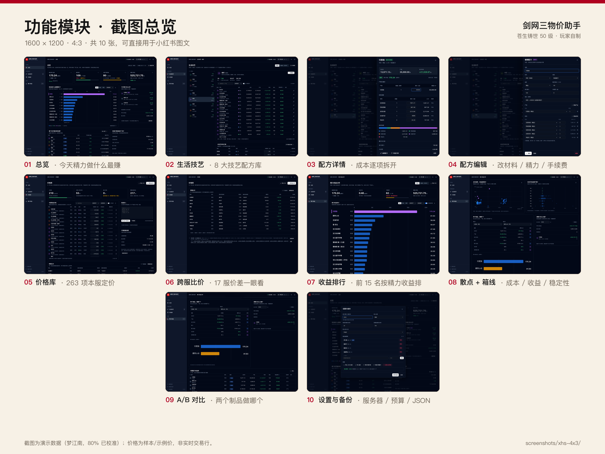

# 剑网三物价助手 · 功能模块介绍与小红书配图文案

> 适用版本：**苍生铸世 · 50 级**（数据 v3.3，核验 2026-11-18）
> 素材目录：[`screenshots/xhs-4x3/`](../screenshots/xhs-4x3/)
> 截图规格：**1600 × 1200（4:3）PNG**，共 11 张 + 1 张联系表
> 用途：小红书图文笔记、功能介绍、工具宣发
> 读者版上手指南：
> - 单页笔记附件版（推荐，3:4，带二维码，不放具体网址）：[`guide-single/剑网三物价助手_小红书图文.pdf`](guide-single/剑网三物价助手_小红书图文.pdf)
> - 8 页详细手册（可选）：[`guide/剑网三物价助手-上手指南-合规版.pdf`](guide/剑网三物价助手-上手指南-合规版.pdf)（附 4:3 分页图）


> **术语说明（发小红书前看）**：工具界面里显示「精力收益 / 利润」，指的是游戏内金币数值；平台文案统一写成「精力效率 / 单次金币」，不要写成现实收益、现金收益或收益承诺。



---

## 0. 一句话定位

**给《剑网3》生活玩家用的「本服物价 → 配方成本 → 精力收益」计算器。**

它不是拍卖行实时数据，而是一套**可以按本服行情校准的生产决策模型**：

- 选服务器，维护本服材料/成品价格；
- 按当前版本配方自动算成本、产值、利润、精力收益；
- 把采集与制造的所有制品放在同一张榜上对比；
- 用满精力模拟回答「这 3000 精力今天怎么花」。

入口：扫 PDF/图片里的二维码，或点「打开物价助手」链接。正文/评论不要写具体网址、域名、微信号。

---

## 1. 功能地图

| # | 模块 | 回答的问题 | 关键能力 | 对应截图 |
| --- | --- | --- | --- | --- |
| 01 | **总览** | 现在做什么最赚精力？今天精力怎么花？ | 4 张 KPI、收益 Top 10、今日建议、技艺总览、本服行情、采集 vs 制造 | `01-overview.png` |
| 02 | **生活技艺** | 某个技艺下有什么可做？成本多少？ | 采集 3 类 / 制造 5 类、配方表、搜索/品阶/仅盈利、材料行情内联改价、新增配方 | `02-skills.png` |
| 03 | **配方详情** | 这个配方到底赚在哪？哪种材料最贵？ | 总成本/产值/单次利润、产物与售价、材料清单、成本构成色条、精力与口径 | `03-recipe-detail.png` |
| 04 | **配方编辑** | 游戏里改了配方，工具里怎么同步？ | 改名称/品阶/等级/精力/手续费/产物/材料；新增自定义配方；恢复示例 | `04-recipe-edit.png` |
| 05 | **价格库** | 本服材料多少钱？哪里缺价？ | 263 项物品、批量粘贴导入、CSV 导出、示例/已校准/缺价三态 | `05-prices.png` |
| 06 | **跨服比价** | 同一件物品哪个服便宜？ | 17 个服务器最高/最低价、价差、价差率 | `06-cross-server.png` |
| 07 | **精力收益排行** | 哪个制品最值得做？差距多少？ | Top 15 排行、全站中位、类型/技艺/品阶筛选、仅数据完整 | `07-analysis-ranking.png` |
| 08 | **散点 + 箱线** | 成本越高收益越高吗？哪个技艺更稳？ | 成本 × 收益气泡散点、各技艺箱线图、离群点 | `08-analysis-charts.png` |
| 09 | **A/B 对比 + 满精力** | 两个制品做哪个？预算怎么分？ | 7 维对比、优势标记、精力收益对比条、贪心分配、可重复制作 | `09-analysis-compare.png` |
| 10 | **设置与备份** | 换服/换设备/改预算怎么办？ | 精力预算、默认精力、成本口径、17 服管理、JSON 导入导出、重置 | `10-settings.png` |
| 11 | **手机端**（加分） | 不想开电脑，能随手查吗？ | 网页版 / 手机端、本机存储、JSON 备份 | `11-mobile-minitool.png` |

> 另有「数据说明」弹窗：版本核验、计算口径、来源与边界。内容偏文字，本次未单独截图，可在笔记正文中说明。

---

## 2. 逐模块介绍

### 01 总览｜今天精力做什么最赚

**画面**：四张 KPI（最优精力收益、盈利配方、本服行情校准、满精力预估）+ 收益 Top 10 条形图 + 今日精力分配 + 技艺总览 + 本服行情卡片。

**解决什么**：上线先看哪张表？这 3000 精力投到哪里？不需要先翻配方，先看结论。

**能做什么**：

- 按「金/精力」排序，直接告诉你当前最优配方；
- 显示盈利 / 亏损 / 数据不全的配方数量，避免只看头部；
- 按 3000 精力预算给出前三名和满预算收益；
- 一键跳到价格库校准行情，或跳到完整分析。

**配文切入点**：把「今天精力做什么」这个每天都会问的问题，变成一张榜。

**截图**：[`01-overview.png`](../screenshots/xhs-4x3/01-overview.png)

---

### 02 生活技艺｜8 大技艺，154 条配方

**画面**：左侧采集 3 类（神农、采金、庖丁）+ 制造 5 类（锻造、缝纫、制药、烹饪、梓匠）；右侧是当前技艺的配方表，含成本、产值、利润、精力、收益/精力、状态。

**解决什么**：某个技艺下到底有哪些可做？每条配方的成本、利润、精力收益分别是多少？

**能做什么**：

- 搜索配方 / 产物，按品阶筛选，勾选「仅看盈利」；
- 表格直接展示成本、产值、利润、精力、收益/精力；
- 下方「本技艺材料行情」可以内联改价，收益即时重算；
- 右上角「新增配方 / 新增采集点」，可自建配方；
- 内置配方带「已核验 / 示例」标识，可恢复示例。

**配文切入点**：「缝纫 39 条配方，成本、产值、利润、精力收益一列排开，不用再开 Excel。」

**截图**：[`02-skills.png`](../screenshots/xhs-4x3/02-skills.png)

---

### 03 配方详情｜成本拆到每一种材料

**画面**：右侧抽屉，展示总成本、产值、单次利润、精力收益；产物与售价表；材料清单（数量、单价、小计、来源）；成本构成色条；精力与口径；数据来源与核验状态。

**解决什么**：这个配方赚在哪？是材料贵、手续费高，还是产物卖不上价？

**能做什么**：

- 材料逐项列出，直接看到哪一种材料占了成本大头；
- 成本构成色条按材料占比着色，颜色即编码；
- 产物单价、材料单价可直接改，抽屉内即时重算；
- 显示「满 3000 精力可做多少次」和毛利率；
- 数据来源与「配方已核验 / 待校验」标识。

**配文切入点**：「点开一条配方，成本拆到每一种材料，终于知道钱花在哪了。」

**截图**：[`03-recipe-detail.png`](../screenshots/xhs-4x3/03-recipe-detail.png)

---

### 04 配方编辑｜游戏改了，30 秒同步

**画面**：编辑抽屉，含名称、技艺、类型、品阶、需求等级、单次精力、手续费、备注、产物与材料行，底部保存/取消/删除。

**解决什么**：当前版本配方有改动、或想加自己的配方，工具里怎么改？

**能做什么**：

- 改任意字段：等级、精力、手续费、产物数量、材料数量；
- 新增自定义配方 / 采集点；新建物品；
- 内置配方可「恢复示例」，自定义配方可删除；
- 修改后立即参与全站收益计算，不需要重建数据。

**配文切入点**：「游戏里改了配方？不用等更新，30 秒改成自己的版本。」

**截图**：[`04-recipe-edit.png`](../screenshots/xhs-4x3/04-recipe-edit.png)

---

### 05 价格库｜263 项物品，批量粘贴

**画面**：四张 KPI（已校准、示例/昨日均价、缺少价格、跨服价差机会）+ 物品价格表 + 批量录入框 + 行情数据说明。

**解决什么**：本服材料/成品到底多少钱？哪些还没填？怎么快速把交易行价格搬进来？

**能做什么**：

- 263 项物品逐项定价，失焦或回车即保存；
- 从交易行/表格复制「物品名 + 价格」，批量粘贴导入；
- 价格状态三态：**已校准 / 示例 / 缺价**；
- 支持搜索、按技艺/类型筛选、仅看缺价；
- 导出 CSV；跨服价差机会统计。

**配文切入点**：「从交易行复制一列价格，粘贴进来就能算，不用一个个手填。」

**截图**：[`05-prices.png`](../screenshots/xhs-4x3/05-prices.png)

---

### 06 跨服比价｜17 个服务器，价差一眼看

**画面**：价格库页下方的「跨服比价」表，列出物品、技艺、最低价服务器、最低价、最高价服务器、最高价、价差、价差率。

**解决什么**：同一件材料/成品，哪个服便宜？哪个服适合上架？

**能做什么**：

- 17 个当前服务器 + 自定义服务器的价格空间；
- 自动计算最高/最低价与价差率；
- 用于换服采购、上架前比价；
- 服务器可增删，每个服独立价格。

**配文切入点**：「同一件材料，17 个服能差出一大截；换服采购/上架前先查一眼。」

**注意**：只做价格对比，不含转服成本、交易限制、市场深度。

**截图**：[`06-cross-server.png`](../screenshots/xhs-4x3/06-cross-server.png)

---

### 07 精力收益排行｜全站 171 条，按精力排队

**画面**：KPI（最高精力收益、全站中位、亏损配方、满精力预估）+ Top 15 横向条形图；支持全部/制造/采集、技艺、品阶、仅数据完整筛选。

**解决什么**：把「每一份精力换成金币」，谁高谁低？差距多少？

**能做什么**：

- 按「利润 ÷ 精力」排序，最多 15 项；
- 虚线标出全站中位，快速判断一个配方值不值得做；
- 颜色区分制造/采集/当前最优；
- 可筛选类型、技艺、品阶，排除数据不全项。

**配文切入点**：「同样 3000 精力，做不同配方，收益能差出几十倍。」

**截图**：[`07-analysis-ranking.png`](../screenshots/xhs-4x3/07-analysis-ranking.png)

---

### 08 散点 + 箱线｜贵的不一定赚

**画面**：左侧「成本越高，收益越高吗？」成本 × 收益气泡散点（气泡大小=精力消耗，紫色=前三）；右侧「各技艺收益稳不稳？」箱线图（箱体=中间 50%，须线=1.5 倍四分位范围，圆点=离群）。

**解决什么**：高成本配方是不是一定高收益？哪个技艺整体更稳？

**能做什么**：

- 一眼看出「高成本低收益」的坑；
- 比较各技艺的中位收益与离散程度；
- 识别离群配方，避免被单个极端值带偏；
- 两张图都可单独导出 PNG。

**配文切入点**：「贵的不一定赚；箱体越短越稳，中位线越靠右整体越好。」

**截图**：[`08-analysis-charts.png`](../screenshots/xhs-4x3/08-analysis-charts.png)

---

### 09 A/B 对比 + 满精力｜两个制品做哪个

**画面**：左侧「两个制品，做哪个？」7 维对比表（总成本、产值、单次利润、精力、精力收益、毛利率、满预算次数）+ 精力收益对比条；右侧「满精力怎么分配？」预算输入、预计总收益、精力用尽、分配列表。

**解决什么**：两个候选配方各有利弊，到底选哪个？3000 精力怎么分？

**能做什么**：

- 同口径逐项对比，优势项用 A/B 标记；
- 同时看「单次利润」与「毛利率」，避免只看绝对值；
- 输入精力预算，按收益从高到低贪心分配，可重复制作；
- 显示预计总收益、精力用尽、剩余精力。

**配文切入点**：「一个单次赚 2.1 万，一个毛利率 82%，你选哪个？」

**注意**：满精力模拟不建模交易税、暴击额外产出、市场深度；可用手续费/材料成本手动修正。

**截图**：[`09-analysis-compare.png`](../screenshots/xhs-4x3/09-analysis-compare.png)

---

### 10 设置与备份｜换服、换设备都不丢

**画面**：精力预算、默认主题、新建采集/制造默认精力、默认成本口径；服务器管理（17 个，可增删）；数据区（导出 JSON 备份、导入备份、清空本服价格、恢复示例配方、重置全部数据）。

**解决什么**：换服务器、换电脑、换手机，数据怎么带走？预算怎么改？

**能做什么**：

- 17 个服务器各自独立价格空间，可新增自定义服务器；
- 改精力预算、默认精力、成本口径；
- 导出/导入完整 JSON 备份；
- 清空本服价格、恢复示例配方、重置全部数据；
- 显示当前数据版本与核验日期。

**配文切入点**：「换电脑不丢数据：JSON 备份一键导入；每个服的价格还互不干扰。」

**截图**：[`10-settings.png`](../screenshots/xhs-4x3/10-settings.png)

---

### 11 手机端（加分项）｜蹲交易行也能查

**画面**：两台手机并排：左侧总览（KPI + 最优收益），右侧精力收益榜（前 15 名）。品牌底色 + 双屏展示。

**解决什么**：不想开电脑，能不能在游戏间隙随手查？

**能做什么**：

- 手机端网页版：打开即用，布局适配竖屏；
- 竖屏布局，总览 / 排行 / 价格 / 配方详情都能用；
- 数据存本机，JSON 备份可迁移。

**配文切入点**：「蹲交易行、等组队、躺床上，随手查本服精力收益。」

**截图**：[`11-mobile-minitool.png`](../screenshots/xhs-4x3/11-mobile-minitool.png)

---

## 3. 可直接发的 4 套笔记

### 方案 A｜9 图合集：一次讲清 9 个功能

**图片顺序**

1. `01-overview.png` 总览
2. `02-skills.png` 生活技艺
3. `03-recipe-detail.png` 配方详情
4. `04-recipe-edit.png` 配方编辑
5. `05-prices.png` 价格库
6. `07-analysis-ranking.png` 精力效率榜
7. `08-analysis-charts.png` 散点 + 箱线
8. `09-analysis-compare.png` A/B 对比 + 满精力
9. `11-mobile-minitool.png` 手机端

**标题（选一个）**

- 剑网3｜154 条生活配方，按本服物价排好队
- 苍生铸世 50 级｜今天精力做什么效率最高？
- 别再手算材料成本了，这个玩家自制工具 3 分钟搞定

**正文**

```text
剑网3 苍生铸世 50 级，生活技艺配方多、材料价格一天一个样。
每次想算「这个配方到底值不值得做」，都要开表格半天。

我把自己在用的「剑网三物价助手」整理出来了：
选服务器 → 填本服价格 → 自动算成本、单次金币、精力效率，
154 条制造配方 + 17 个采集点，全部排在一张榜上。

这组图带你看完 9 个核心功能：
1️⃣ 总览：今天精力做什么效率最高
2️⃣ 生活技艺：采集 3 + 制造 5，按技艺查配方
3️⃣ 配方详情：成本拆到每一种材料
4️⃣ 配方编辑：游戏里改了什么，30 秒同步
5️⃣ 价格库：263 项物品，支持批量粘贴
6️⃣ 精力效率榜：前 15 名 + 全站中位
7️⃣ 散点/箱线：贵的不一定效率高，稳不稳定一眼看
8️⃣ A/B 对比 + 满精力：两个制品做哪个
9️⃣ 手机端：蹲交易行也能随手查

⚠️ 说明：配方来自 第三方攻略站 当前版本；
价格是本服样本/示例价，不是实时交易行数据。
所有价格都能自己改，改完立即重算。

入口：扫 PDF 里的二维码，或点「打开物价助手」链接；正文不要写具体网址。
```

**标签**：`#剑网3 #剑网三 #剑网3苍生铸世 #生活技艺 #剑网3攻略 #精力 #游戏工具`

---

### 方案 B｜单点：精力效率榜（3 图）

**图片顺序**：`07-analysis-ranking.png` → `08-analysis-charts.png` → `09-analysis-compare.png`

**标题（选一个）**

- 剑网3｜全站 171 条配方，精力效率第一名是？
- 苍生铸世｜把每一份精力换成金币，差距有多大
- 别再问「做什么效率高」了，这张榜直接抄

**正文**

```text
同样 3000 精力，做不同配方，效率能差出几十倍。
我把 171 条配方按「单次金币 ÷ 精力」排了个序：

🏆 第一名 归营旌（梓匠）175.24 金/精力
🥈 瞒然心动（烹饪）81.63
🥉 定魂丹砂（制药）58.09

榜单还能按制造/采集、技艺、品阶筛选，
虚线的位置是全站中位，低于它的配方基本可以观望。

图 2 左边是「成本 × 效率」散点：
越靠上效率越高，越靠右占用资金越多；
右边是各技艺箱线图：箱体越短越稳。

图 3 可以两个制品逐项对比，
还能按 3000 精力算满预算分配。

⚠️ 截图是梦江南演示数据，价格为样本/示例价，
不是实时交易行；换成你所在服的价格，榜单会全部重算。
```

**标签**：`#剑网3 #剑网三 #苍生铸世 #生活技艺 #精力效率 #剑网3攻略 #游戏工具`

---

### 方案 C｜教程：3 步校准本服价格（4 图）

**图片顺序**：`05-prices.png` → `03-recipe-detail.png` → `01-overview.png` → `09-analysis-compare.png`

**标题（选一个）**

- 剑网3｜3 步把生活技艺效率算准（附工具）
- 别再拿别服价格算效率了，先校准本服行情
- 生活技艺成本总算不对？大概率少了这一步

**正文**

```text
为什么你算的效率和交易行对不上？
大概率是材料价格用了别服/旧价。

我用「剑网三物价助手」的流程：
① 右上角选本服（17 个服 + 自定义）
② 价格库批量粘贴：从交易行复制「物品名 + 价格」，
   一次导入，只匹配已有物品
③ 回总览看 Top 10，点配方看成本拆解

价格库会标三种状态：
🟢 已校准 / ⚪ 示例价 / 🔴 缺价
缺价的配方会提示「效率被低估」，补完再算。

图 4 是我常看的「满精力分配」：
输入 3000 精力，按效率从高到低分，能重复做。
只做计算，不含交易税/暴击/市场深度，别当数值承诺。

⚠️ 数据版本 v3.3，配方来自 第三方攻略站 当前版本；
价格为样本/示例价，请以本服交易行为准。
```

**标签**：`#剑网3 #剑网三 #生活技艺 #剑网3教程 #游戏工具 #苍生铸世 #剑网3攻略`

---

### 方案 D｜手机端 / 网页版（3 图）

**图片顺序**：`11-mobile-minitool.png` → `01-overview.png` → `07-analysis-ranking.png`

**标题（选一个）**

- 剑网3｜不用开电脑，手机也能查本服精力效率
- 蹲交易行的时候，我会打开这个工具
- 生活技艺计算器，终于有手机版了

**正文**

```text
以前算配方要开电脑、切表格，
现在手机点开就能看：

📱 总览：四张 KPI + 精力效率榜
📊 效率榜：前 15 名 + 中位线
💰 价格库：本服价格随手改
🧮 配方详情：成本拆解、材料改价

入口：扫 PDF 里的二维码，或点「打开物价助手」链接，
数据存在本机，换设备用 JSON 备份导入。

⚠️ 同样：样本/示例价，不是实时交易行；
配方是当前版本精选，不是逐条完整数据。
```

**标签**：`#剑网3 #剑网三 #生活技艺 #游戏工具 #剑网3攻略`

---

## 4. 发布建议

### 比例与封面

- 本次素材统一为 **4:3（1600 × 1200）**，同一篇笔记建议保持同一比例。
- 如果封面想用竖版，项目里已有 **3:4 首图**：[`brand/cover-3x4-1080x1440.png`](../brand/cover-3x4-1080x1440.png)。
- 若整篇都用 4:3，建议用 `01-overview.png` 作首图，或在图片编辑里加大标题。
- 首图文字控制在 12 字以内，例如：「今天精力做什么效率最高？」

### 标题与正文

- 标题带版本/等级/收益关键词：`苍生铸世`、`50 级`、`精力`、`生活技艺`。
- 正文 3–5 段，每段不超过 3 行；多用「→」和 emoji 分隔。
- 数字只作为演示，不要写成「全服统一效率」。
- 正文不要放具体网址、域名、微信号；二维码可以放在 PDF/图片里。

### 标签

建议 5–8 个，从以下组合里选：

`#剑网3` `#剑网三` `#剑网3苍生铸世` `#生活技艺` `#剑网3攻略` `#精力` `#精力效率` `#游戏工具`

### 互动引导

- 「你所在服的第一名是谁？评论区对一下」
- 「下期想看哪个技艺的配方拆解？」
- 「不会批量导入的，评论区扣 1，我出教程」

### 平台合规检查

发布前逐条过一遍：

- ✅ **二维码放对位置**：可以放在 PDF/图片里；正文/评论不写具体网址、域名、微信号。
- ✅ **PDF 可以挂**：笔记支持附件时直接传单页版 PDF；只能发图时用同名 PNG。
- ✅ **不写导流词**：「免费领取」「主页自取」「评论区拿链接」都不要用。
- ✅ **只讲游戏内数值**：不涉及任何现实交易或游戏外服务。
- ✅ **不承诺数值**：写「仅游戏内数值，仅供参考」，不写「稳赚」「包回本」。
- ✅ **非官方声明**：玩家自制，与游戏厂商无关联。

---

## 5. 口径与合规

### 计算公式

```text
材料成本 = Σ（材料数量 × 材料单价）
总成本   = 材料成本 + 手续费
产值     = Σ（产物数量 × 产物单价）
利润     = 产值 − 总成本
精力收益 = 利润 ÷ 精力
毛利率   = 利润 ÷ 产值
```

- **市场价口径**：材料按填入的本服单价。
- **取最低口径**：每个材料取 `min(市场价, 自制成本/产出数量)`，递归计算；只优化材料成本，不把自制中间产物的精力计入最终配方。
- **采集**：按单次采集点的多产出计算，稀有掉率按期望值折算；单次精力可编辑。
- **满精力模拟**：按精力收益从高到低贪心分配，可重复制作；不建模交易税、暴击额外产出与市场深度。

### 数据来源

- 制造配方 / 等级 / 精力 / 材料 / 产出范围：**JX3BOX 技艺助手 API（2026-11-18）**，收录 154 条当前版本代表配方 + 17 个采集点。
- 价格：JX3BOX 17 个服务器拍卖样本；无报价/样本不足时回退梦江南示例价。
- 版本：苍生铸世 50 级，数据 v3.3，核验 2026-11-18。
- 旧版本（90/100/130 级）配方与精力数值不兼容，已整体切换。

### 必须说明的边界

- **不是实时交易行数据**，而是可校准的生产决策模型。
- 交易行手续费/税费、暴击额外产出、署名溢价、跨服交易限制**未自动建模**。
- 采集点的产出数量与精力为示例，需按游戏内实测校准。
- 配方库为当前版本精选，不是逐条完整数据；可在界面内修改或导入 JSON。
- 所有截图中的数字均为演示数据，**不构成收益承诺**。

### 发布用免责声明

> 玩家自制工具，非官方，与游戏厂商无关联；仅讨论游戏内生活技艺数值，不涉及任何现实交易或游戏外服务；配方来自第三方攻略站当前版本样本，价格为样本/示例价，可自行校准；计算结果仅供参考，请以游戏内交易行为准。

---

## 6. 素材清单与重拍

### 文件

| 文件 | 尺寸 | 说明 |
| --- | --- | --- |
| `00-contact-sheet.png` | 1600 × 1200 | 10 张功能截图联系表 |
| `01-overview.png` | 1600 × 1200 | 总览 |
| `02-skills.png` | 1600 × 1200 | 生活技艺 |
| `03-recipe-detail.png` | 1600 × 1200 | 配方详情（1.35× 界面缩放） |
| `04-recipe-edit.png` | 1600 × 1200 | 配方编辑（1.25×） |
| `05-prices.png` | 1600 × 1200 | 价格库 |
| `06-cross-server.png` | 1600 × 1200 | 跨服比价 |
| `07-analysis-ranking.png` | 1600 × 1200 | 精力收益排行 |
| `08-analysis-charts.png` | 1600 × 1200 | 散点 + 箱线 |
| `09-analysis-compare.png` | 1600 × 1200 | A/B 对比 + 满精力 |
| `10-settings.png` | 1600 × 1200 | 设置与备份（1.12×） |
| `11-mobile-minitool.png` | 1600 × 1200 | 手机端双屏（加分图） |

### 演示数据状态

- 服务器：梦江南；`80% 已校准`（210 / 263）；53 项示例价；0 项缺价。
- 预算：3000 精力。
- 主题：暗色。
- 价格：内置 JX3BOX 样本/示例价，**非实时**。

### 重拍

```bash
cd JX3-AH-Calculator
python3 -m http.server 8931
# 浏览器打开 http://127.0.0.1:8931
```

用 Playwright / Chromium，视口 **1600 × 1200**，逐页截图。建议沿用同一套演示状态，避免不同图片里的服务器、校准比例、预算数字互相矛盾。

详细说明见 [`screenshots/xhs-4x3/README.md`](../screenshots/xhs-4x3/README.md)。

---

## 7. 快速索引

- [总览](#01-总览今天精力做什么最赚)
- [生活技艺](#02-生活技艺8-大技艺154-条配方)
- [配方详情](#03-配方详情成本拆到每一种材料)
- [配方编辑](#04-配方编辑游戏改了30-秒同步)
- [价格库](#05-价格库263-项物品批量粘贴)
- [跨服比价](#06-跨服比价17-个服务器价差一眼看)
- [精力收益排行](#07-精力收益排行全站-171-条按精力排队)
- [散点 + 箱线](#08-散点--箱线贵的不一定赚)
- [A/B 对比 + 满精力](#09-ab-对比--满精力两个制品做哪个)
- [设置与备份](#10-设置与备份换服换设备都不丢)
- [手机端](#11-手机端加分项蹲交易行也能查)
- [4 套笔记](#3-可直接发的-4-套笔记)
- [口径与合规](#5-口径与合规)
